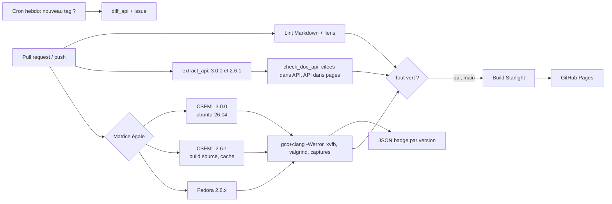

# 10 — Workflow de fiabilité : génération de la référence, tests, CI, mises à jour

Recherche du 2026-11-07 (PHASE 1 : rien compilé, rien installé). Versions d'actions lues via `https://api.github.com/repos/<owner>/<repo>/releases/latest` le 2026-11-07. Faits CSFML lus dans le clone `repos/CSFML` (branche master, dernier commit 2026-11-01).

## En bref

- **Parité 2.6 / 3.0 :** la CI a une matrice avec **poids égal** : chaque exemple, chaque page de référence et chaque contrôle tourne pour CSFML 3.0.0 **et** 2.6.1. Un échec sur l'une des deux bloque la fusion. [DÉCISION]
- **Référence générée depuis les en-têtes.** Recommandation : un petit script Python avec **libclang** (paquet PyPI `libclang`) qui lit `include/CSFML/*.h` (3.x) et `include/SFML/*.h` (2.6) et écrit un JSON `api/csfml-<ver>.json`. Doxygen XML sert de complément pour les commentaires `\brief`. [DÉDUIT, À TESTER]
- CSFML sait déjà générer du HTML Doxygen : option CMake `CSFML_BUILD_DOC` (OFF par défaut), dossier `doc/` avec `doxyfile.in`. Mais `GENERATE_XML = NO` : le XML est désactivé dans leur Doxyfile, il faut le réactiver chez nous. [CONFIRMÉ, `doc/doxyfile.in` et `CMakeLists.txt` sur master]
- Les commentaires des en-têtes sont riches en `\brief` (1083 occurrences dans `include/` sur master) mais presque sans exemple (`\code` : 12 occurrences). La doc doit donc écrire ses propres exemples. [CONFIRMÉ, `grep -rho` sur master ; le chiffre « 916 fonctions avec \brief » du brief vient d'une autre méthode de comptage, non recoupé]
- Deux contrôles automatiques : (1) toute fonction `sf...` citée dans une page existe dans l'API de la bonne version ; (2) toute fonction de l'API a une page ou une entrée. Un script de ~100 lignes, sans dépendance lourde.
- Exemples : vrais `.c`, compilés avec `-Wall -Wextra -Werror` (gcc **et** clang), exécutés sous `xvfb-run` avec Mesa llvmpipe, fermés après N frames, avec capture d'image optionnelle, puis valgrind.
- Runner : `ubuntu-24.04` (= `ubuntu-latest`) a CSFML **2.6.0** dans apt ; `ubuntu-26.04` a CSFML **3.0.0**. Les deux runners existent. Le paquet apt est la voie rapide, le build depuis les sources avec cache est le repli. [CONFIRMÉ pour les noms de runners ; versions des paquets : 08-architecture-site.md §6]
- **Attention :** apt 24.04 donne 2.6.0, pas 2.6.1. Pour tester 2.6.1 il faut compiler le tag 2.6.1 (ou utiliser un conteneur Fedora, qui est en 2.6.1 d'après l'utilisateur). [DÉDUIT, À TESTER]
- Mises à jour : Renovate/Dependabot pour les actions et npm ; workflow programmé qui détecte un nouveau tag CSFML, génère `api/csfml-<nouveau>.json` et le diff avec le précédent.

---

## 1. Générer la référence depuis les en-têtes

### 1.1 Ce que fait déjà CSFML
- `doc/` contient `CMakeLists.txt`, `doxyfile.in`, `doxygen.css`, `footer.html`, `header.html.in`, `mainpage.hpp`, `searchOverrides.css`. [CONFIRMÉ, `git ls-tree master doc/`]
- Le CMake racine déclare `CSFML_BUILD_DOC` (OFF par défaut) ; si ON, il ajoute le sous-dossier `doc`, qui cherche Doxygen (`find_package(Doxygen REQUIRED)`) et crée la cible `doc`. [CONFIRMÉ, `CMakeLists.txt` lignes ~35 et ~73 ; `doc/CMakeLists.txt`]
- Réglages utiles du `doxyfile.in` : `INPUT` = `include/CSFML`, `EXTRACT_ALL = YES`, `WARN_AS_ERROR = YES`, `MACRO_EXPANSION = YES` avec `PREDEFINED` pour les macros `CSFML_*_API`, `GENERATE_XML = NO`. [CONFIRMÉ, master]
- Le paquet Ubuntu `libcsfml-doc` existe (dépendance de `epitech-cpool`, voir 08 §6) : c'est ce HTML Doxygen. Il n'y a **aucune doc API en ligne pour 2.6** : c'est pour cela que la parité est importante.
- À vérifier : le tag 2.6.1 a-t-il le même dossier `doc/` et les mêmes macros ? [À TESTER : `git show 2.6.1:doc/doxyfile.in`]
- Pièges : les macros `CSFML_GRAPHICS_API` etc. (nombre d'occurrences : Graphics 508, Audio 202, Network 232, Window 105, System 25, master) doivent être déclarées dans `PREDEFINED`, sinon les parseurs ne voient pas les fonctions. [CONFIRMÉ pour les comptes]

### 1.2 Comparaison des outils

| Outil | Principe | Pour | Contre | Verdict |
|---|---|---|---|---|
| Doxygen XML + script Python | Doxygen parse, on lit `xml/*.xml` | Donne `\brief`, `\param`, `\return` déjà rangés ; CSFML a déjà un Doxyfile | Il faut réactiver `GENERATE_XML`, régler les macros ; XML verbeux ; Doxygen à installer | **Complément** pour les textes |
| libclang (`pip install libclang`) | Vrai parseur C : liste fonctions, types, paramètres, commentaires | Signatures exactes (types résolus), fonctionne sur les deux versions, un seul paquet pip | Il faut les bons `-I` et `-D` ; l'API Python est bas niveau | **Recommandé** pour le JSON d'API |
| pycparser | Parseur C pur Python | Simple, sans compilateur | Ne comprend pas les `#include` sans préprocesseur ; gère mal les commentaires ; il faut `gcc -E` avant | Possible mais plus fragile |
| tree-sitter-c | Arbre syntaxique tolérant | Rapide, tolère les macros inconnues | Pas de résolution de types ; extraction à écrire à la main | Bon pour un simple contrôle de noms |
| ctags (universal-ctags) | Index de symboles | Très simple, une commande | Peu de détails (pas de paramètres propres) | Suffit pour « la fonction existe ? » |

**Recommandation :** deux niveaux. (a) `ctags` ou une regex sur `CSFML_*_API` pour le contrôle rapide des noms ; (b) `libclang` pour `api/csfml-<ver>.json` (nom, module, header, type retour, paramètres, `\brief`, marqueur `CSFML_DEPRECATED`). Doxygen XML reste une option si libclang gêne. [DÉDUIT : à valider sur un prototype]

Précédent dans cette recherche : un script regex a donné 926 fonctions pour 3.0.0, identique à `nm -D` des `.so` installés (08 §6). Le regex est donc un bon **contrôle croisé** du JSON libclang. [CONFIRMÉ]

### 1.3 Contenu généré et contenu écrit à la main
- **Généré :** nom, signature, module, header, `\brief`, paramètres, statut déprécié, « depuis » (via diff entre versions).
- **Écrit (IA + relecture) :** explication, pièges, exemple `.c`, lien vers guides.
- Chaque page de référence porte en en-tête (frontmatter) la version testée ; la signature affichée vient du JSON, jamais tapée à la main. [DÉCISION]

---

## 2. Contrôles automatiques (tools/)

1. `extract_api.py <tag>` : produit `api/csfml-<tag>.json` (versionné dans git).
2. `check_doc_api.py` :
   - **citées ⊂ API :** extrait tout `sf[A-Z]\w+` des pages et des `.c`, vérifie qu'il existe dans le JSON de la version de la page (3.x → 3.0.0 ; `legacy`/2.6 → 2.6.1). Échec sinon. Exceptions listées dans `tools/allowlist.txt` (ex. noms d'anciennes fonctions cités dans la migration).
   - **API ⊂ pages :** chaque fonction du JSON apparaît dans au moins une page de référence. Échec (ou avertissement au début) sinon.
3. `diff_api.py A B` : fonctions ajoutées, retirées, déprécier, signature changée → liste de pages à revoir.
4. Les pages de migration 2→3 sont vérifiées dans les deux sens (ancien nom dans l'API 2.6.1, nouveau dans 3.0.0).

---

## 3. Exemples réels compilés et exécutés

### 3.1 Principe
- Un exemple = un dossier `examples/<ver>/<module>/<slug>/` avec `main.c` + `example.json` (modules à lier, nombre de frames, capture, audio). Structure de 08 §5. Le site affiche exactement ce `main.c`.
- Le code de l'exemple doit être **complet et correct pour un étudiant** : il garde sa vraie boucle `while (sfRenderWindow_isOpen(...))`. Le mode test est injecté **hors du code affiché** (voir 3.4).

### 3.2 Compilation
- `gcc -std=c11 -Wall -Wextra -Werror` et `clang` (Epitech utilise `CC=clang`, voir a-tester-01 n°3). Lier avec `-lcsfml-graphics -lcsfml-window -lcsfml-system` (+ audio/network selon `example.json`) ; ordre des options : voir 02-install.md §4.2.
- Variante : `pkg-config --cflags --libs csfml-all` (le binaire `pkg-config` est à installer dans le runner si absent, 02 §4.4).
- Sanitizers : build séparé `-fsanitize=address,undefined -g` ; ASan peut avoir des faux positifs avec les pilotes GL, à tester. [À TESTER]

### 3.3 Écran, GPU, audio sans matériel
- Écran virtuel : `xvfb-run -a -s "-screen 0 1280x720x24" ./exemple`. Paquets Ubuntu : `xvfb`, `libgl1-mesa-dri` (Mesa llvmpipe, rendu logiciel), `libegl1`. Variables utiles : `LIBGL_ALWAYS_SOFTWARE=1`. [DÉDUIT, À TESTER] Le runner `ubuntu-26.04` contient `xvfb` (2:21.1.22-1ubuntu1.3, lu dans son README https://github.com/actions/runner-images/blob/main/images/ubuntu/Ubuntu2604-Readme.md). [CONFIRMÉ]
- CSFML 3.0.0 demande un contexte OpenGL ; llvmpipe fournit OpenGL 4.5 (à confirmer sur le runner). Sur Xvfb, certaines fonctions de fenêtre (plein écran, curseur) peuvent ne rien faire. [INCERTAIN]
- Audio sans carte son : miniaudio (utilisé par SFML 3) a un backend « null » ; sans périphérique, `sfSound_play` doit échouer proprement. Option : installer `pulseaudio` + sink null (`pactl load-module module-null-sink`) ou `pipewire`. Les tests audio marquent `audio: true` dans `example.json` et sont d'abord lancés en « compile seulement » si le périphérique manque. [INCERTAIN, À TESTER]
- Tests réseau : uniquement sur `127.0.0.1` (serveur et client dans le même test) ; jamais d'Internet en CI.

### 3.4 Mode test : fermeture après N frames
Problème : on ne veut pas modifier le code affiché. Solutions, par ordre de préférence :
1. **`ld --wrap`** : un fichier `tests/harness/doc_wrap_3x.c` redéfinit `__wrap_sfRenderWindow_display` pour compter les frames et appeler `sfRenderWindow_close` après N (même idée pour `pollEvent` afin d'injecter un événement `Closed`). Édition de liens : `-Wl,--wrap=sfRenderWindow_display`. Des `doc_wrap_26.c` séparé car les noms/signatures diffèrent (3.0 : `sfRenderWindow_pollEvent` remplit un `sfEvent*` avec un type `sfEvent` union changée, voir 04-migration). [DÉDUIT, À TESTER]
2. `LD_PRELOAD` d'une petite bibliothèque : plus souple, mais ne marche pas si le symbole est résolu statiquement.
3. Variable d'environnement `DOC_TEST_FRAMES` lue par une macro dans l'exemple : rejeté, pollue le code affiché.

### 3.5 Capture et comparaison
- 3.0.0 : fenêtre vers image via `sfTexture_create` + `sfTexture_update...` ou `sfRenderWindow_capture` / `sfTexture_copyToImage` puis `sfImage_saveToFile`. **Les noms exacts de ces fonctions ne sont pas confirmés dans les en-têtes lus pour ce document** : [À VÉRIFIER avec `tools/extract_api.py`, 3.0.0 et 2.6.1].
- Comparaison : `tests/compare_images.py` (Pillow) avec tolérance (llvmpipe peut varier selon la version de Mesa). Les PNG de référence sont rangés par version CSFML : `tests/references/<csfml-version>/<slug>.png`. En cas d'écart : artefact CI « diff » ; mise à jour de la référence uniquement par une PR relue. [DÉCISION]
- Les captures servent aussi d'**illustrations de la doc** : l'image affichée sur le site est celle produite par la CI. [DÉCISION]

### 3.6 Mémoire
- `valgrind --error-exitcode=1 --leak-check=full --suppressions=tests/suppressions/valgrind-mesa.supp` : les pilotes Mesa produisent du bruit, d'où le fichier de suppressions. Le but principal : vérifier que les exemples appellent bien tous les `sf*_destroy`. Valgrind est lent avec llvmpipe : limiter à N=30 frames. [DÉDUIT, À TESTER]

---

## 4. Matrice de CI — poids égal 3.0.0 / 2.6.1

| Cellule | Image | Obtention de CSFML | Cible |
|---|---|---|---|
| `csfml-3.0.0` | `ubuntu-26.04` | `apt install libcsfml-dev` (3.0.0-1) | exemples `examples/3.x` |
| `csfml-2.6.1-src` | `ubuntu-24.04` | build tag 2.6.1 + SFML 2.6.x dans `$HOME/.local/csfml`, mis en cache | exemples `examples/2.6` |
| `csfml-2.6.x-fedora` | conteneur `fedora:latest` | `dnf install CSFML-devel` (nom à vérifier) | idem, contrôle « le paquet réel » |
| `csfml-2.6.0-apt` | `ubuntu-24.04` | `apt install libcsfml-dev` (2.6.0-3build1) | idem, tolérance : fonctions 2.6.1 exclues |
| `csfml-3.0.0-src` (optionnel) | `ubuntu-24.04` | build tag 3.0.0 + SFML 3.0.2 | contrôle indépendant du paquet distro |
| `csfml-master` (non bloquant) | `ubuntu-26.04` | build master | alerte précoce 3.1 |

- Les cellules 3.0.0 et 2.6.1 sont **bloquantes** ; `master` est `continue-on-error`.
- Conteneurs alternatifs pour 2.6 : `ubuntu:24.04`, `fedora:latest`, Debian 13 (paquet `libcsfml-dev` : version [À VÉRIFIER], l'API sources.debian.org n'a pas répondu le 2026-11-07).
- Fedora : l'utilisateur indique 2.6.1 ; nom du paquet et version [À VÉRIFIER avec `docker run fedora dnf info`]. Docker 29.1.3 est présent localement pour ces tests de phase 2.
- Build depuis les sources : s'inspirer de la CI officielle de CSFML (`.github/workflows/ci.yml` sur master : compile SFML au tag `SFML_VERSION` puis CSFML, `ubuntu-24.04`, liste de paquets de dev : `libxrandr-dev libxcursor-dev libxi-dev libudev-dev libflac-dev libvorbis-dev libgl1-mesa-dev libegl1-mesa-dev libfreetype-dev libharfbuzz-dev ...`). [CONFIRMÉ] La recette locale est dans 02-install.md §3.5. Cache : `actions/cache` avec clé `csfml-${{ matrix.csfml }}-${{ runner.os }}-<hash du script de build>`.
- Pièges 2.6.x : SFML 2.6.x (pas 3) doit être associé à CSFML 2.6.x ; le tag exact de SFML à utiliser pour 2.6.1 est à confirmer. [À VÉRIFIER]



---

## 5. Squelette de workflow [À TESTER, jamais exécuté]

Versions d'actions lues le 2026-11-07 (API `releases/latest`) :

| Action | Version | Date |
|---|---|---|
| `actions/checkout` | v7.0.1 | 2026-07-20 |
| `actions/cache` | v6.1.0 | 2026-06-26 |
| `actions/upload-artifact` | v7.0.2 | 2026-10-07 |
| `actions/setup-python` | v7.1.0 | 2026-10-22 |
| `actions/setup-node` | v7.1.0 | (date non lue) |
| `actions/deploy-pages` | v5.0.1 | (date non lue) |
| `actions/github-script` | v9.0.0 | 2026-04-09 |
| `lycheeverse/lychee-action` | v2.9.0 | 2026-07-09 |
| `DavidAnson/markdownlint-cli2-action` | v25.0.0 | 2026-10-25 |
| `withastro/action` | v6 (lu dans 08) | — |

On épingle idéalement par SHA complet (Renovate met à jour). Le SHA n'a pas été relevé : [À TESTER].

```yaml
name: ci
on: [push, pull_request, workflow_dispatch]
permissions: { contents: read }
concurrency: { group: ci-${{ github.ref }}, cancel-in-progress: true }

jobs:
  api:
    runs-on: ubuntu-26.04
    steps:
      - uses: actions/checkout@v7
      - uses: actions/setup-python@v7
        with: { python-version: "3.13" }
      - run: pip install libclang
      - run: python tools/extract_api.py --tag 3.0.0 --tag 2.6.1   # clone/archive des tags
      - run: python tools/check_doc_api.py
      - uses: actions/upload-artifact@v7
        with: { name: api, path: api/ }

  examples:
    needs: api
    strategy:
      fail-fast: false            # parité : on voit toutes les cellules
      matrix:
        include:
          - { csfml: "3.0.0", os: ubuntu-26.04, source: apt }
          - { csfml: "2.6.1", os: ubuntu-24.04, source: build }
    runs-on: ${{ matrix.os }}
    steps:
      - uses: actions/checkout@v7
      - name: Paquets communs
        run: sudo apt-get update && sudo apt-get install -y xvfb libgl1-mesa-dri valgrind clang pkg-config python3-pil
      - name: CSFML par apt
        if: matrix.source == 'apt'
        run: sudo apt-get install -y libcsfml-dev
      - name: Cache build CSFML
        if: matrix.source == 'build'
        id: cache
        uses: actions/cache@v6
        with:
          path: ~/.local/csfml
          key: csfml-${{ matrix.csfml }}-${{ matrix.os }}-${{ hashFiles('tests/build_csfml.sh') }}
      - name: Build CSFML depuis les sources
        if: matrix.source == 'build' && steps.cache.outputs.cache-hit != 'true'
        run: tests/build_csfml.sh ${{ matrix.csfml }} "$HOME/.local/csfml"
      - name: Compiler et lancer les exemples
        env: { CSFML_VERSION: "${{ matrix.csfml }}", CSFML_PREFIX: "${{ matrix.source == 'build' && '$HOME/.local/csfml' || '' }}" }
        run: xvfb-run -a tests/run_examples.sh examples/${{ startsWith(matrix.csfml, '3') && '3.x' || '2.6' }}
      - name: Badge
        run: python tools/make_badge.py --csfml ${{ matrix.csfml }} --status ok --out badge-${{ matrix.csfml }}.json
      - uses: actions/upload-artifact@v7
        with: { name: badge-${{ matrix.csfml }}, path: "badge-*.json" }

  docs-quality:
    runs-on: ubuntu-26.04
    steps:
      - uses: actions/checkout@v7
      - uses: DavidAnson/markdownlint-cli2-action@v25
        with: { globs: "src/content/docs/**/*.{md,mdx}" }   # MDX : support à vérifier
      - uses: lycheeverse/lychee-action@v2
        with: { args: "--no-progress --accept 200,429 'src/content/docs/**/*.mdx'" }
```

Notes : (1) `tests/build_csfml.sh` est à écrire d'après 02-install.md §3.5. (2) Pour Fedora, ajouter un job avec `container: fedora:latest` (le container remplace `runs-on` image mais pas `ubuntu-*` hôte, et `sudo` n'existe pas dans le conteneur : utiliser `dnf` directement). (3) Pour la liaison de pages, le plugin `starlight-links-validator` (08) vérifie les liens internes à la build ; `lychee` vérifie les liens externes, en tâche programmée plutôt qu'à chaque PR (limites de débit). (4) `markdownlint` ne comprend pas toujours le MDX : [INCERTAIN].

Déploiement : `withastro/action` + `actions/deploy-pages`, **seulement si les jobs ci sont verts** (voir 08 §3.1).

---

## 6. Badge « testé sur CSFML x.y.z »

- Chaque cellule de matrice écrit `badge-<ver>.json` au format *endpoint* de shields.io (`{"schemaVersion":1,"label":"testé sur","message":"CSFML 3.0.0","color":"brightgreen"}`), https://shields.io/badges/endpoint-badge. [CONFIRMÉ pour le format ; à tester]
- Hébergement : publier ces JSON dans le site (GitHub Pages) à `/badges/csfml-3.0.0.json`, puis `https://img.shields.io/endpoint?url=...`. Aucune clé ni service payant.
- Sur chaque page : composant `Tested.astro` lit `tested: ["3.0.0","2.6.1"]` du frontmatter ; la CI **vérifie** que cette liste est vraie (l'exemple a passé dans cette cellule). Un badge ne se saisit jamais à la main. [DÉCISION]

---

## 7. Mises à jour futures

- **Dépendances :** Renovate (config `renovate.json`) ou Dependabot (`.github/dependabot.yml`, écosystèmes `github-actions` et `npm`) ; regroupement hebdomadaire. Choix : Dependabot (aucune app à installer, natif GitHub). [DÉCISION, À TESTER]
- **Nouveau tag CSFML :** workflow `watch-csfml.yml` programmé (`schedule: cron`, hebdomadaire) qui liste `git ls-remote --tags https://github.com/SFML/CSFML`, compare à `api/` et, pour un nouveau tag (ex. 3.1.0) : lance `extract_api.py`, `diff_api.py 3.0.0 3.1.0`, ouvre une issue avec la liste des pages à revoir, et ajoute une cellule de matrice. Master est déjà en `project(CSFML VERSION 3.1.0)` (08 §6).
- **2.6 :** pas de nouvelle version attendue (2.6.1 est la dernière, 2024-05-19). Le contrôle continue de tourner : ainsi on détecte un changement de paquet de distro (Fedora, Ubuntu).
- **Distros :** un job programmé `apt-cache policy libcsfml-dev` / `dnf info` dans les conteneurs, qui alerte quand la version change.
- Une règle simple : **aucun texte « depuis X » sans diff d'API qui le confirme**.

---

## 8. Checklist de relecture humaine (par page, avant fusion)

1. Le titre et la description disent la même chose que le contenu.
2. Chaque fonction citée est dans le JSON d'API de la version annoncée (le contrôle auto passe).
3. La page indique clairement la ou les versions testées (badge généré).
4. L'exemple affiché est le vrai `main.c` et il a passé en CI sur la cellule de la page.
5. L'exemple libère toutes les ressources créées (`sf*_destroy`), pas de fuite valgrind.
6. Les pièges (NULL retourné, ressource à détruire, ordre d'appel) sont signalés.
7. Les différences 2.6 / 3.0 sont dites, avec un lien vers la page de migration.
8. Les termes anglais importants ont leur traduction à la première apparition.
9. Aucune signature « de mémoire » : tout vient du header.
10. Les liens internes et externes fonctionnent (lychee, validator).
11. Les images viennent de la CI et ont un texte alternatif.
12. Les licences des assets (police, son, image) sont notées dans `examples/assets/LICENSES.md`.
13. La page FR et la page EN disent la même chose (ou l'avis de repli est affiché).
14. Aucune affirmation sans source (page de référence → lien vers le header du tag).
15. Les unités et cas limites (NULL, fenêtre fermée, tableau vide) sont mentionnés quand le header les évoque.

---

## Décisions prises

1. **Parité stricte :** matrice CI avec cellules bloquantes pour CSFML 3.0.0 **et** 2.6.1, mêmes contrôles, mêmes sections de doc. 2.6 n'est pas « legacy mineure » (décision utilisateur).
2. Référence générée par **libclang** (JSON versionné dans `api/`), Doxygen XML en complément, regex/ctags en contrôle croisé.
3. Deux contrôles bloquants : citées ⊂ API, et couverture API → pages (avertissement au début, bloquant ensuite).
4. Exemples : vrais `.c`, `-Wall -Wextra -Werror` en gcc et clang, xvfb + llvmpipe, `ld --wrap` pour le mode test, valgrind avec suppressions Mesa.
5. 2.6.1 est testé par build depuis les sources (cache), car apt 24.04 est en 2.6.0 ; Fedora en cellule supplémentaire.
6. Badge JSON endpoint shields.io produit par la CI, hébergé sur le site.
7. Dependabot pour actions et npm ; cron hebdomadaire pour les nouveaux tags.
8. Actions épinglées aux versions du tableau §5 (idéalement SHA complet).

## Points [INCERTAIN]

- Fonctions de capture d'écran exactes en 3.0.0 et 2.6.1 : à lire dans l'API extraite.
- Nombre « 916 fonctions avec \brief » : non recoupé (je compte 1083 `\brief` dans `include/`, qui incluent types et énumérations).
- Version de CSFML dans Fedora et Debian 13 ; nom du paquet Fedora.
- Tag SFML 2.6.x à associer à CSFML 2.6.1 pour le build.
- Faisabilité audio sans carte son, ASan et valgrind avec llvmpipe sur le runner.
- Version llvmpipe/OpenGL du runner `ubuntu-26.04` (non lue).
- Dates de `setup-node` v7.1.0 et `deploy-pages` v5.0.1 non lues ; `withastro/action` v6 repris de 08.
- Le support de markdownlint pour MDX.
- Valeur de `GENERATE_XML` et macros dans le Doxyfile du tag 2.6.1.
